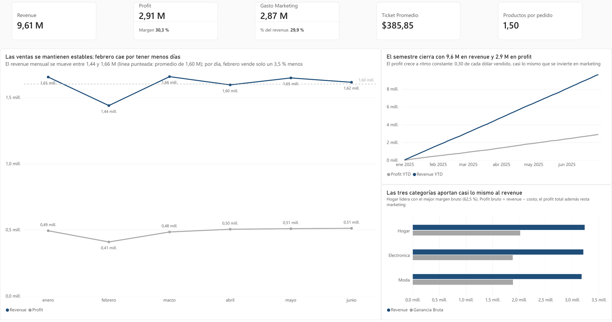
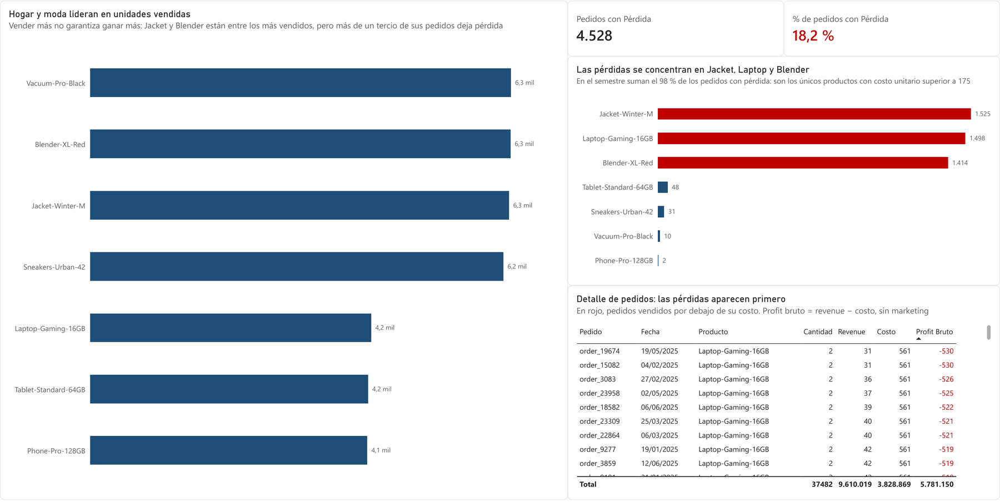

# RappiPlus: de los datos a las decisiones de negocio

Diagnóstico integral del servicio RappiPlus en el primer semestre de 2025: calidad de datos en Python, rentabilidad, funnel de conversión y retención por cohortes en SQL, un experimento A/B sobre el checkout y un dashboard en Power BI. Proyecto final del bootcamp de Análisis de Datos de TripleTen.

**Resultado principal:** el negocio es rentable (profit de USD 2,91 M y margen de 30,3 %), pero el marketing consume casi tanto como la ganancia, el 18,2 % de los pedidos se vende por debajo del costo y el mayor abandono ocurre al pedir los datos de pago.

[Ver el notebook](analisis_rappiplus.ipynb) · [Abrir en Google Colab](https://colab.research.google.com/github/fvt1999pipe-eng/analisis_rappiplus/blob/main/analisis_rappiplus.ipynb) · [Descargar el dashboard (.pbix)](dashboard_rappiplus.pbix)

## Contexto y objetivo

RappiPlus es un servicio de delivery con operación en varios países de Latinoamérica. La dirección quería saber si el negocio gana dinero, en qué punto de la compra se pierden los usuarios y si vuelven, antes de decidir dónde invertir. El objetivo es responder esas preguntas con datos limpios y convertir cada respuesta en una recomendación concreta.

## Preguntas de negocio

1. ¿Podemos confiar en los datos?
2. ¿El negocio es rentable?
3. ¿Dónde se pierden los usuarios?
4. ¿Los usuarios regresan?
5. ¿Un cambio en la interfaz del checkout mejora la conversión?

## Resultados

| Pregunta | Hallazgo | Recomendación |
|---|---|---|
| Calidad de los datos | Los pedidos pasan de 25.100 a 24.906 registros (−0,77 %): 100 duplicados, 14 con valores inválidos o atípicos y 80 sin datos para calcular revenue y costo. Se recuperaron 50 categorías y 101 canales de marketing. | Los datos son confiables para el análisis. |
| Rentabilidad | Revenue de USD 9,61 M, costo de productos de USD 3,83 M, marketing de USD 2,87 M y profit de USD 2,91 M (margen de 30,3 %). El marketing equivale al 29,9 % del revenue. paid_search deja USD 1,13 de profit por cada dólar invertido, frente a USD 0,96 de social y organic. | Reasignar presupuesto de social hacia paid_search y revisar la eficiencia del gasto en México. |
| Funnel de conversión | Conversión final del 80,0 % (6.240 de 7.796 usuarios). La mayor pérdida está entre el inicio del checkout y el ingreso de los datos de pago: 958 usuarios (13,3 %). | Optimizar el paso de pago y recordar la compra a quien abandona el checkout. |
| Retención por cohortes | Cerca del 42 % de cada cohorte está activa cada semana, estable entre el 39,8 % y el 44,0 %; baja a 40,6 % en la semana 4. | Acciones de reactivación para el 58 % de usuarios inactivos en una semana dada. |
| Experimento A/B del checkout | Tratamiento 16,29 % frente a control 15,69 % (+0,60 puntos). z = 0,813; p = 0,416: no significativo. | No implementar la nueva interfaz esperando más ventas y enfocar el próximo experimento en el paso de pago. |
| Dashboard | 4.528 pedidos (18,2 %) se venden por debajo del costo; el 98 % se concentra en Jacket-Winter-M, Laptop-Gaming-16GB y Blender-XL-Red. Laptop-Gaming-16GB pierde USD 93.622 antes de marketing. | Fijar un precio mínimo por producto que cubra su costo. |

## Metodología

1. **Calidad de los datos (Python, pandas):** revisión de duplicados, nulos, valores inválidos y atípicos; recuperación de categorías y canales de marketing mal escritos; cálculo de revenue y costo por pedido cruzando con el catálogo.
2. **Rentabilidad:** revenue, costo de productos, gasto en marketing y profit, con el retorno de cada canal de marketing y país.
3. **Funnel de conversión (SQL):** usuarios únicos en cada etapa de eventos, desde la primera visita hasta la compra, y pérdida entre pasos consecutivos.
4. **Retención por cohortes (SQL):** cohortes por mes de registro y porcentaje de usuarios activos en las semanas 1 a 4 después del registro.
5. **Experimento A/B (statsmodels):** prueba Z de dos proporciones entre control y tratamiento, con un nivel de significancia de 0,05.
6. **Dashboard (Power BI):** modelo estrella, medidas DAX y validación de los totales contra los calculados en Python.

## Dashboard en Power BI



*Overview. Revenue de USD 9,61 M, profit de USD 2,91 M y un gasto en marketing equivalente al 29,9 % del revenue; las ventas mensuales son estables.*



*Detalle. 4.528 pedidos (18,2 %) se venden por debajo del costo, concentrados en Jacket-Winter-M, Laptop-Gaming-16GB y Blender-XL-Red.*

El dashboard tiene tres páginas: **Overview** (visión ejecutiva), **Detalle** (diagnóstico por producto y pedido) y **Pedidos por producto** (destino del drill-through, al que se llega con clic derecho sobre un producto en la página Detalle).

- **Modelo estrella:** `catalog_clean` y una tabla calendario `Dim_Fecha` (DAX con `CALENDAR` y `ADDCOLUMNS`) filtran a `orders_clean` y `marketing_clean`, con relaciones 1:* de dirección única.
- **Medidas DAX:** Revenue, Costo Total (`SUMX` con `RELATED`), Gasto Marketing, Ganancia Bruta, Profit, Margen, Ticket Promedio, Cantidad Promedio, Revenue y Profit YTD (`TOTALYTD`) y Pedidos con Pérdida.
- Los totales del modelo coinciden con los calculados en Python.

### Limitaciones

- El periodo cubre solo el primer semestre de 2025, así que no captura la estacionalidad de un año completo.
- El profit descuenta el costo de productos y el marketing; el dataset no incluye otros costos operativos como logística o plataforma.
- Que el experimento no sea significativo no prueba que la nueva interfaz no tenga efecto: con una diferencia de 0,6 puntos, detectarla exigiría una muestra mayor.
- El funnel y las cohortes miden actividad de los usuarios, no el ingreso que genera cada uno.

## Datos

| Fuente | Contenido |
|---|---|
| `rappiplus_orders_raw.csv` | 25.100 pedidos con precios, descuentos y monto total |
| `rappiplus_catalog.csv` | 7 productos con su costo unitario, categoría y proveedor |
| `rappiplus_marketing_spend.csv` | 1.620 registros de inversión en marketing por canal, campaña y país |
| Tablas `events`, `users` y `user_activity` | Comportamiento de los usuarios en la plataforma (PostgreSQL) |
| `experiment_checkout_ui.csv` | 10.000 usuarios de un experimento A/B sobre la interfaz del checkout |

Los datos son un caso de estudio ficticio del bootcamp de Análisis de Datos de TripleTen: no corresponden a cifras reales de ninguna empresa. La base de datos SQL del caso no es pública: las credenciales se leen de variables de entorno y no se incluyen en el repositorio.

## Estructura del repositorio

```
analisis_rappiplus/
├── analisis_rappiplus.ipynb   Notebook con el análisis completo
├── dashboard_rappiplus.pbix   Dashboard en Power BI
├── img/                       Capturas del dashboard
├── requirements.txt           Librerías necesarias
└── README.md
```

## Cómo reproducir el análisis

1. Clona el repositorio e instala las librerías:

   ```bash
   git clone https://github.com/fvt1999pipe-eng/analisis_rappiplus.git
   cd analisis_rappiplus
   pip install -r requirements.txt
   ```

2. Abre `analisis_rappiplus.ipynb` en Jupyter. Las secciones 1, 2 y 5 leen los CSV desde su ubicación pública; las secciones 3 y 4 necesitan acceso a la base de datos del caso, configurado en las variables de entorno `DB_USER`, `DB_PASSWORD`, `DB_HOST` y `DB_NAME`.
3. Abre `dashboard_rappiplus.pbix` con Power BI Desktop.

## Herramientas

Python · pandas · statsmodels · SQL (PostgreSQL) · SQLAlchemy · Power BI · DAX · Jupyter

## Autor

**Felipe Vásquez Torres**, analista de datos con experiencia en supply chain y operaciones.

[LinkedIn](https://www.linkedin.com/in/felipe-vasquez-torres) · [Portafolio](https://fvt1999pipe-eng.github.io) · fe.vasqueztorres@gmail.com
